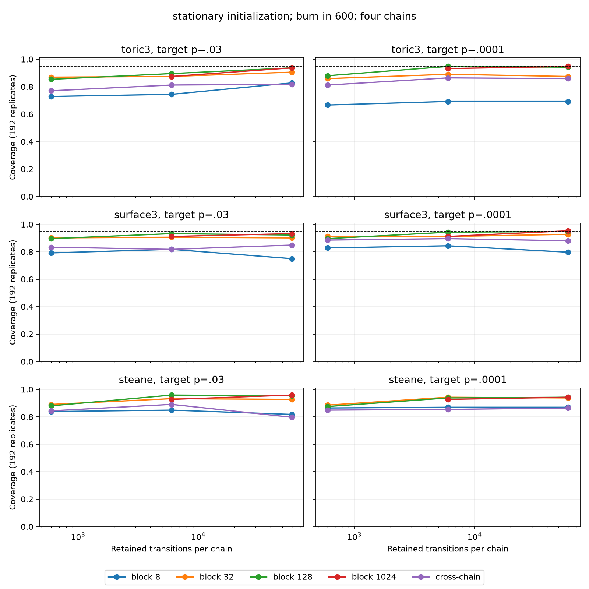
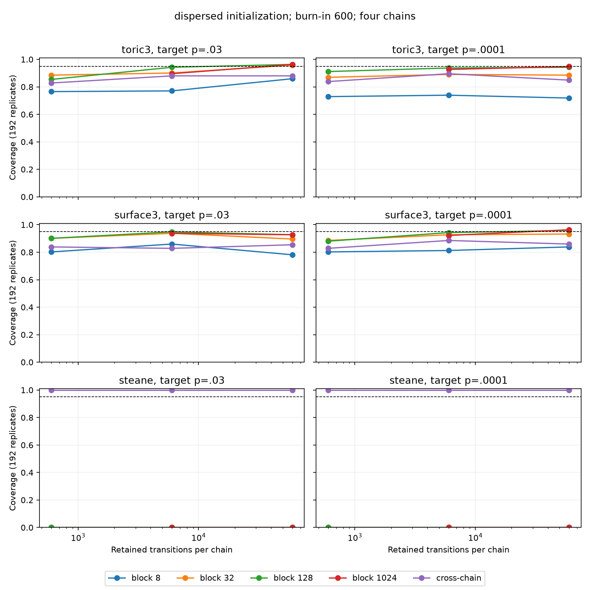

# 固定cohortクラスタ校正の完了報告（2026-10-17）

## 結論

全46,080本のtrace、2,304解析group、64,512解析行の計算・監査・回収を完了した。
欠落・記録されたsampling失敗・区間未取得は全て0件であり、97 archive内の145,449ファイルをローカルでもSHA-256照合した。
ただし、計算の完了は混合や名目95%被覆の達成を意味しない。
今回の固定BP-OSDを用いるSteaneでは、既定Z/Hの失敗条件付きchainが可約であり、dispersed初期化の大きなbiasは長さやburn-inでは解消しないことを有限状態の全列挙で確認した。
toric3・surface3でも全条件の95%被覆は達成しておらず、4chainのcross-chain区間は過小被覆が残った。
公開既定は変更しないが、既定Z/Hを一般的な混合保証として推奨する根拠はなく、Steaneでは成分を結ぶ提案の追加校正を優先する。

## 1. 固定した実験と評価範囲

事前の設計は [クラスタ設計](calibration_cluster_design_2026-10-17_ja.md)、実装と投入は [実装報告](tile_cluster_report_2026-10-17_ja.md)、監査と事後解析の仕様は [監査仕様](calibration_audit_spec_2026-10-17_ja.md) に保存した。
manifestと稼働中のdriver・wheelを変更せずに完了させた。

| 項目 | 実行条件 |
|---|---|
| 符号・decoder | toric3（18qubits）・surface3（13qubits）はMWPM、Steane（7qubits）は固定prior 0.03のBP-OSD |
| BP-OSD | max_iter=100、min_sum、osd_cs、order=2 |
| noise | 独立・一様bit-flip、decoderはladder内で固定 |
| ladder | [0.1, 0.07, 0.05, 0.03]、[0.03, 0.01, 0.003, 0.001, 0.0003, 0.0001] |
| 初期化 | stationary：exact条件付き分布から独立抽出、dispersed：決定論的な4個のfailure状態 |
| 反復 | 各符号・ladder・初期化につき192 replicate、各rungに4chain |
| raw trace | 各chain 66,000遷移、棄却・lazyを含む、合計3,041,280,000遷移 |
| 後処理window | 保存長600・6,000・60,000、burn-in 600・6,000、同じraw traceから切り出す |
| kernel | Z=0.7、H=0.3、cluster_k=2、lazy=0.05 |
| 誤差法 | 円環block bootstrap長8・32・128、および保存長6,000以上で1024、bootstrap 1,000回、cross_chain |
| anchor・truth | 全列挙によるexact、anchor分散0 |
| 区間 | pooled BAR点推定にlog SE×1.959963984540054を加減し指数変換、上端は1でclip |

4chain・明示した初期化・exact anchorの実験であり、公開既定の1chainや自動anchorを含む全ワークフローの直接校正ではない。
別のnoise、p依存decoder、回路noise、大きい符号への外挿はしない。
Tile72/288は別のsmokeで実行済みだが、今回のexact被覆cohortには含めていない。
Tileの長trace校正と独立referenceの構築は後続課題である。

## 2. 完了・整合性・回収の証拠

全投入はPBSのqsubを用いた。
各ジョブは1ノード96CPUで、samplingの2本のafterok依存列と、その後の解析・監査により同時最大2ノードを守った。

| Job ID | 役割 | 終了コード | PBS実測walltime |
|---|---|---:|---|
| 265188 | smoke | 0 | 00:01:11 |
| 265189 | exact bank | 0 | 00:00:06 |
| 265190 | sampling shard0 | 0 | 00:08:24 |
| 265191 | sampling shard1 | 0 | 00:08:26 |
| 265192 | sampling shard2 | 0 | 00:08:25 |
| 265193 | sampling shard3 | 0 | 00:08:26 |
| 265194 | 解析・集計 | 0 | 00:47:37 |
| 265195 | 全件監査・archive作成 | 0 | 00:00:44 |

Job IDの末尾は全て `.node-PRISM` である。
再投入は不要だった。
投入台帳と完了時のPBS状態は [データ索引](data_calibration_2026-10-17/README.md) から参照できる。

| 要求 | 確認した証拠と範囲 |
|---|---|
| manifest・欠落・重複 | 固定manifestから全期待keyを再生成し、46,080 traceと2,304 groupのinventoryを完全一致で照合 |
| 失敗・区間未取得 | 全64,512行を照合、sampling失敗0、利用可能区間64,512、未取得0 |
| traceの妥当性 | 全markerのNPZ/JSON hash、seed、初期状態、model/decoder/kernel/source、長さ66,000、dtype・値域・exact bankの支持を照合 |
| failure定義 | 3符号の全270,464状態を公開Problem.is_faultyで再判定し、bankの欠落・余分がないことを確認 |
| 解析の整合性 | BAR root方程式、covariance・SE・区間・被覆flag、観測量平均とtraceを全groupで照合 |
| 集計の整合性 | 全64,512行から336条件各192 replicateの分母・bias・RMSE・被覆・Wilson区間と対応差を独立再集計 |
| 回収 | 97 archive、1,636,106,601 bytes、全145,449 payloadのsize・SHA-256・欠落・重複をローカルで検証 |

検査結果は [audit.json](data_calibration_2026-10-17/results/audit.json) と [recovery.json](data_calibration_2026-10-17/results/recovery.json) に保存した。
リモート監査の所要時間は41.40秒、ローカルarchive全件照合は47.37秒だった。
compact traceはweight・syndrome weight・残余logical bitmaskを保持し、全物理状態そのものは保存していない。
したがってbank支持と観測量の整合性を検査しており、全物理軌道を再構成したという主張ではない。

| 識別子 | SHA-256等 |
|---|---|
| 基準HEAD | `6f7528645ddf988ed8008bad5c81e321aa2aaaf8` |
| 配置bundle SHA-256 | `482b3bfdb4100aacc014c880f7f6dc85ad649fb0f7d31dad202fa0b877cdc9b1` |
| production manifest digest | `3782bf338b0a0a1fa69d9f5c1a3157adb9e6ff288f3bcc873590a51021d0d89d` |
| audit.json SHA-256 | `dfd6e24f0ca98480131292cd6bfaa2f59bb6b4af55e4433953f16f82c6008a95` |

## 3. 長いtraceのbias・RMSE・被覆

次表は保存長60,000、burn-in 6,000、各4chain、192 replicateである。
相対biasは `(平均推定値−truth)/truth`、相対RMSEは `sqrt(平均二乗誤差)/truth` とし、表では百分率で示す。
点推定は誤差法間で同じであり、block128とcross-chainの違いは区間にある。
screen欄は第5節の事後診断flagが1個以上あるreplicate数であり、分母から除外していない。

| 符号 | target p | 初期化 | 相対bias% | 相対RMSE% | block128被覆 | cross-chain被覆 | screen/192 |
|---|---:|---|---:|---:|---:|---:|---:|
| toric3 | 0.03 | stationary | -0.008297 | 0.330285 | 186/192 | 157/192 | 0 |
| toric3 | 0.03 | dispersed | -0.015010 | 0.295984 | 184/192 | 165/192 | 0 |
| toric3 | 0.0001 | stationary | -0.014862 | 0.706201 | 180/192 | 166/192 | 0 |
| toric3 | 0.0001 | dispersed | 0.124367 | 0.706861 | 178/192 | 167/192 | 0 |
| surface3 | 0.03 | stationary | 0.033122 | 0.269895 | 175/192 | 160/192 | 0 |
| surface3 | 0.03 | dispersed | 0.017578 | 0.271309 | 177/192 | 166/192 | 0 |
| surface3 | 0.0001 | stationary | 0.012561 | 0.237755 | 181/192 | 165/192 | 0 |
| surface3 | 0.0001 | dispersed | 0.042161 | 0.225963 | 185/192 | 168/192 | 0 |
| steane | 0.03 | stationary | 0.018931 | 0.079218 | 182/192 | 164/192 | 0 |
| steane | 0.03 | dispersed | -92.153561 | 92.153561 | 0/192 | 192/192 | 192 |
| steane | 0.0001 | stationary | 0.002496 | 0.035683 | 182/192 | 163/192 | 146 |
| steane | 0.0001 | dispersed | -99.998955 | 99.998955 | 0/192 | 192/192 | 192 |

Steane dispersedを除いた同じ長さ・burn-inでの被覆範囲は、block8が131–173/192、block32が166–181/192、block128が175–186/192、block1024が176–187/192だった。
cross-chainは157–168/192（81.8–87.5%）で、名目95%より低い。
このcross-chain条件ではRMS log SEと反復間log推定値SDの比が約0.94–1.10でも被覆は不足し、平均的なSEの大きさだけでは区間の校正を判断できない。
4chainによる分散推定の不確実性と正規分位点の組合せは検討候補だが、原因をこの実験だけで確定しない。
surface3・p=0.03・stationary・block128の175/192に対するWilson区間は[0.86279, 0.94398]で、0.95を含まない。
toric3・同p・stationaryの186/192では[0.93351, 0.98560]である。
これらは各条件の記述用区間であり、多重比較を補正した全条件共通の保証ではない。

## 4. 長さ・burn-in・初期化の比較

次表はstationary、burn-in 600、block128に固定し、保存長だけを変えた結果である。
各欄は「被覆数/192；相対RMSE%」を示す。

| 符号 | target p | 保存600 | 保存6,000 | 保存60,000 |
|---|---:|---|---|---|
| toric3 | 0.03 | 164/192；3.7453% | 172/192；1.1844% | 180/192；0.3416% |
| toric3 | 0.0001 | 169/192；7.0517% | 182/192；2.1298% | 181/192；0.6882% |
| surface3 | 0.03 | 172/192；2.5268% | 179/192；0.7988% | 177/192；0.2725% |
| surface3 | 0.0001 | 172/192；2.3093% | 181/192；0.7582% | 182/192；0.2339% |
| steane | 0.03 | 169/192；0.7807% | 184/192；0.2356% | 183/192；0.0791% |
| steane | 0.0001 | 168/192；0.3894% | 180/192；0.1303% | 181/192；0.0380% |

これらのstationary条件では保存長100倍に対してRMSEはおおむね10分の1になったが、被覆は単調には改善しない。
保存長60,000・block128でburn-inを600から6,000へ増やした被覆差は−3/192から+6/192で、一貫した改善はなかった。
長さ・burn-in・誤差法は同じraw traceに対応する比較であり、独立な標本として差のSEを計算していない。
初期化間はreplicate IDを対応させたが乱数streamは独立であり、共通乱数比較ではない。
全816対応比較とそのSEは [paired_comparisons.csv](data_calibration_2026-10-17/results/paired_comparisons.csv) に保存した。
Steane dispersedでは全ての長さ・burn-inでblock区間の被覆が0/192、cross-chainが192/192となり、初期化の影響は長時間でも残った。

保存長と全誤差法の比較図はburn-in 600に固定しており、第3節のburn-in 6,000の表とは条件が異なる。

図のPDF版も同じresultsディレクトリに保存した。

## 5. 混合診断と未定義値

監査で340,992診断行を整理し、符号・ladder・初期化・burn-in・保存長・rung・観測量ごとの1,776条件へ集計した。
R-hat>1.01、最小chain ESS<100、診断未定義のいずれかを事後screenとして記録した。
この閾値は事前の収束判定ではなく、flagの有無から収束・正しさを証明しない。
exact分散0のlogical indicatorは構造的定数として分離し、単にconstant traceであるという理由で混合失敗に数えない。
一方、exact分散が正なのにtraceがconstantとなる場合の未定義診断は残す。
全1,776条件のIAT・ESS・R-hatの中央値と90/99%点、exact平均からのbias・RMSE、未定義数は [mixing_summary.csv](data_calibration_2026-10-17/results/mixing_summary.csv) にある。
exact平均との比較はweight・syndrome weight・logical indicatorに限り、Bennett寄与のexact平均欄は空欄である。
分位点は定義された値だけのnearest-rank集計なので、未定義が多い条件で高ESSを健全性の証拠にしない。

保存長60,000・burn-in 6,000ではtoric3とsurface3の全8cohortでscreenは0/192だったが、cross-chainと一部blockの被覆不足は残った。
toric3の低p最終rungではlogical indicatorの最大chain IATの中央値は約50、最小chain ESSの中央値は約1,200で、weightのIAT中央値約34より遅い。
surface3の低p最終rungのweight IAT中央値は約11だった。
Steane stationaryの低pでは146/192 replicateに未定義診断があり、最終rungのweightだけでも140/192が未定義だった。
同条件の小さい点推定biasや182/192のblock128被覆を、エルゴード性の証拠とは扱わない。
Steane dispersedのweight R-hat中央値はp=0.03で約21.8、p=0.0001の定義済み値で約468となり、後者の最終rung weightは175/192が未定義だった。
診断未定義とBAR区間未取得は別の問題であり、今回のBAR区間未取得は0である。
screenあり・なしの条件付き被覆もCSVに保存したが、主集計は常に全192 replicateを保持する。

## 6. Steaneの原因を調べた事後の全列挙

この節は結果取得後の追加解析であり、事前固定cohortとは区別する。
今回の固定decoderについて全128状態を列挙すると、failureは64状態で、weight 0〜7の個数は `[0,0,21,7,28,0,7,1]` だった。
公開Zanella・ClusterExchange(k=2)の提案確率とMH受理・棄却・lazyを使って全failure間の遷移行列を構成した。
Zはweightを±1だけ変え、Hはweightを保つため、failureのないweight 5を越えられず、weight 2–4の56状態とweight 6–7の8状態が別の連結成分になる。
正規化・詳細釣合い・stationarityは数値精度内で成立していても、既約性は成立しない。
lazyによる非周期性はこの分断を解消しない。

dispersed初期状態はindex `[3,127,5,63]`、weight `[2,7,2,6]` で、各成分に2chainずつ固定される。
実際の高weight成分の条件付きmassはp=0.03で約3.03e-7、p=0.0001で約3.33e-17なのに、pooled traceは同成分を50%含み続ける。
各成分内で正確に平衡化した50:50混合をBennett方程式へ入れた極限と、長traceの観測結果は次のとおりである。

| target p | exact truth | 50:50混合のBAR極限 | 極限の相対bias% | 観測の相対bias% |
|---|---:|---:|---:|---:|
| 0.03 | 0.01641809782 | 0.001288316268 | −92.153072 | −92.153561 |
| 0.0001 | 2.099020210e-7 | 2.193369574e-12 | −99.998955 | −99.998955 |

cross-chainはこの成分間の差から非常に広い区間を作り、重大なbiasがあっても192/192を被覆した。
50:50極限のcross-chain区間もそれぞれ約[7.25e-5, 2.29e-2]、[5.09e-18, 9.45e-7]でtruthを含む。
したがって100%被覆を良い点推定や正しい混合の指標にしてはいけない。
stationary初期化は初期時点の周辺分布を正しくするが、任意初期値からの混合を保証しない。

候補としてZ/H/stabilizer=0.6/0.3/0.1も全failure対で検査した。
p=0.1・0.03・0.0001で1連結成分となり、正規化・stationarity・詳細釣合いを確認し、最大詳細釣合い誤差は4.34e-19だった。
これは今回の有限状態に対する接続性の確認であり、低pでの混合時間、被覆、他decoderや他符号での有効性は未検証である。
公開既定と本校正のkernelは変更していない。
全成分、mass、検査値、極限値は [steane_components.json](data_calibration_2026-10-17/results/steane_components.json) に保存した。

## 7. 公開既定と次の計測の判断

1. 公開既定Z/Hを普遍的に使える混合設定とは扱わず、今回のSteaneの反例をAPI文書へ追加する。
2. Steaneでは長さ追加より先に、成分を結ぶstabilizer等の提案を固定した新しい小規模pilotを行い、支持・詳細釣合い・非周期性と初期化依存を確認してから独立cohortを校正する。
3. block長を増やすだけでは点推定biasや非連結性は直らず、block1024も全条件の95%被覆を保証しないため、誤差法の公開既定をこの表だけで変更しない。
4. cross-chainは4chainで過小被覆が残るので、16/32chainや有限chain数に対応する区間構成を事前固定して比較する。
5. tileと大きい符号、phase/depolarising/circuit noise、自動MC anchorの不確実性は別cohortと独立referenceの予算を立てて追加する。

上記の追加校正は未実施であり、今回の完了範囲を超える次段階として残す。
既定を据え置くことは統計的な妥当性を認定することではない。
今回得た根拠は「一般的な保証はできない」「Steaneのこの構成は提案supportの修正が必要」という判断であり、代替設定の一般的な採用基準までは満たさない。

## 8. データ・再現・検証記録

全64,512行の [coverage_rows.csv.gz](data_calibration_2026-10-17/results/coverage_rows.csv.gz)、全336条件の [coverage_summary.csv](data_calibration_2026-10-17/results/coverage_summary.csv)、混合診断・対応比較・図をresultsに保存した。
raw archiveはローカル `A:/dev/mcmc4qec/output/cluster_results/20261017-calibration/archives/` とリモート `/home/user/workspace/mcmc4qec/20261017-tile-calibration-v1/runs/audit-v1/archives/` に保持する。
大きいraw archiveはgitignore対象のoutputにあり、文書側に [archive一覧](data_calibration_2026-10-17/results/archives.json) と [全file inventory](data_calibration_2026-10-17/results/inventory.jsonl.gz) を保存した。
exactな配置先と回収コマンドは [データ索引](data_calibration_2026-10-17/README.md)、一般的な投入・再開手順は [driver README](../../cluster_scripts/README.md) を参照する。
全archiveを展開しなくても `verify_recovery.py` で全payloadを照合できる。
再集計は `summarize_calibration.py`、Steaneの有限状態解析は `steane_components.py` で再現できる。

監査・回収・集計の有限受入テストは9 passed・2.95秒で、意図的な欠落・余分なfile・marker不足・不正な区間flag・covarianceと、未取得を含む分母を検査した。
Steaneの有限状態受入テストは1 passed・14.92秒で、既定と候補の接続性・正規化・詳細釣合い・stationarity・自己loopを検査した。
最終の文書・監査・回収・有限状態テストは16 passed・13.02秒で、文書と成果物の確認を [completion_validation.json](data_calibration_2026-10-17/completion_validation.json) に保存した。
先行するtile・driver・wheel検証の結果と制約は実装報告に残し、この追加解析で全suiteやremote CIを再実行したとは扱わない。
RIMCへの書込み、commit、push、公開設定の変更は実施していない。
