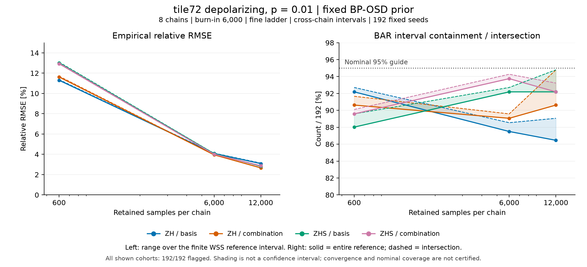

# tile72 depolarizing・p=.01のtrace長比較

8 chain・burn-in 6,000・fine ladder・cross-chain誤差法を固定し、ZH/ZHSとlogical_basis/logical_combinationの4組を比較した。
各点の分母は事前固定した192 seedであり、保存長600・6,000・12,000は同じ各chainから切り出した窓である。
線は観測した3点を結ぶ表示であり、中間の保存長を実測したものではない。

左図は有限WSS参照区間の全域に対する経験的相対RMSEの最小値から最大値である。
WSSの部分重量和や区間中点を完全な点referenceとして使っていない。
右図の実線はBAR区間がWSS区間全体を含むseedの割合、破線はWSS区間と交差するseedの割合である。
真値がWSS区間にある場合、このcohortの真値被覆率は各点の両値の間にあるが、WSS区間自体の被覆は確実ではない。
陰影は統計的な信頼帯や母RMSEの信頼区間ではなく、95%の点線は名目水準の目安である。

このsliceでは保存長とともに経験的RMSEが小さくなる一方、区間被覆は全てのkernel・初期化で単調に改善するわけではない。
全12表示cohortの全192 seedに混合診断の警告が残り、収束や名目被覆を保証しない。
短いtraceを採用すべきという結論や推奨設定の選択には使わない。

入力12行は`plot_data.csv`、入力・出力hashとPython・Matplotlib環境は`provenance.json`に保存した。
図はPNGとSVGを提供し、文字の欠落・重なり・軸・凡例・制約注記をPNGで目視確認した。
再現scriptは`../plot_low_case2_target0_trace_length_v1.py`で、既存出力は上書きしない。
再実行は別の空の出力先へ`OUT`を変更し、その変更を記録する。
