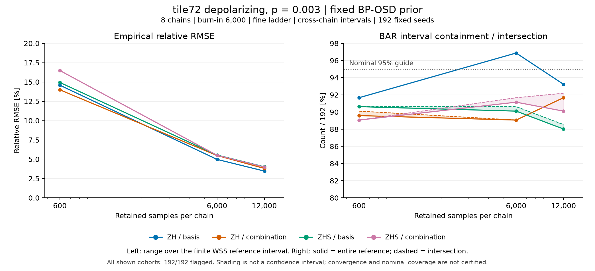

# tile72 depolarizing・p*=.003のtrace長比較

固定BP-OSD prior、8 chain、burn-in 6,000、fine ladder、cross-chain区間、各192 seedの条件で保存長を比較した。
4系列はZH/ZHSとlogical_basis/logical_combinationの組合せである。
入力は別算術照合済みの全設定CSVから選んだ12行で、計算や不確かさの再推定は行っていない。

左は有限WSS参照区間内を動かした経験的相対RMSEの範囲を示す。
保存長600では13.98〜16.50%、6,000では4.98〜5.54%、12,000では3.46〜4.02%だった。
右の実線はBAR区間がWSS区間全体を含む割合、破線は両区間が交差する割合で、分母は全192 seedである。
95%の水平線は名目値の目安であり、実測被覆の保証や設定選択基準ではない。
RMSEはこの比較で低下したが、参照区間の包含・交差は一様には改善していない。

全12行で全192 seedに診断flagが残った。
診断未定義seedは保存長600で192/192、6,000で191〜192/192、12,000で139〜152/192であり、分母から除外していない。
同じchainの保存窓を比較しているため、点間の差を独立な有意性検定の結果とは扱わない。
帯は参照区間への感度または包含・交差の差であり、統計的信頼帯ではない。
混合・収束・名目95%被覆や推奨設定を確定する図ではない。

元値は`plot_data.csv`、SVGは`trace_length_comparison.svg`、入力・出力hashと実行環境は`provenance.json`に保存した。
再現scriptは`../plot_low_case2_target1_trace_length_v1.py`で、既存出力を残して別の空の`OUT`を指定する。
provenance SHAは`cac7d17dec9da61e38193b6706c3ed137c29821eb73f90aabe630629c40faf65`である。
