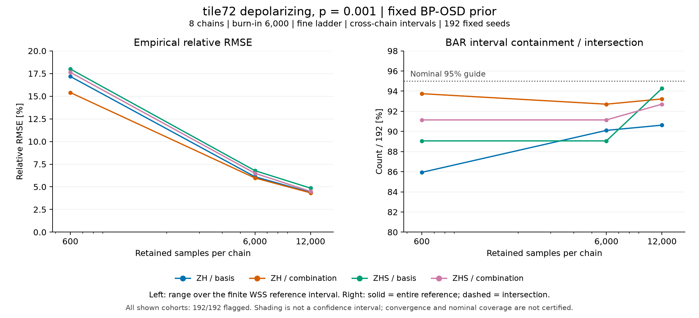

# tile72 depolarizing・p*=.001の保存長比較

8 chain・burn-in 6,000・fine ladder・cross-chain区間に固定し、ZH/ZHSとlogical_basis/logical_combinationの4設定を比較した。
左は有限WSS参照区間内での相対RMSE範囲で、帯は統計的信頼区間ではない。
右はBAR区間によるWSS区間全体の包含率を実線、交差率を破線で示し、今回の12点では両件数が等しく重なっている。
分母は各192 seedで、全点で点推定・区間を取得したが、全seedに診断flagと未定義診断が残る。
600・6,000・12,000は同じchainの保存窓であり、独立な比較実験ではない。
RMSE低下を収束や名目95%被覆の保証とは扱わず、推奨設定は選んでいない。

元データ12行は`plot_data.csv`、入力・出力hashと実行環境は`provenance.json`、再現scriptは`../plot_low_case2_target2_trace_length_v1.py`にある。
PNGとSVGを保存し、PNGのタイトル・凡例・軸・注記と全曲線が欠けていないことを目視確認した。
