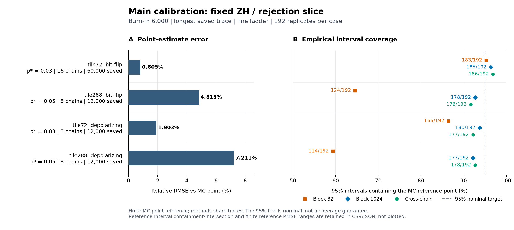

# Tile code-capacity論理エラー率推定：中間報告

2026-10-18時点の確認済み結果と適用限界をまとめる。
主4条件のsampling・BAR解析・保存データ監査・最終再集計・混合診断比較と独立計時の精度・時間比評価は完了した。
低ノイズ本校正と独立計時は未完了であり、本稿は最終的な推奨設定や精度保証を与える報告ではない。
最新の実行状態は [進捗文書](tile_validation_status_2026-10-17_ja.md)、固定条件と判断基準は [事前計画](tile_validation_plan_2026-10-17_ja.md) に記録する。

15:22 JST時点で、主4条件・各768群のfull trace監査は全て正常終了した。
合計190,464 traceの全compact点と保存initial/checkpointを検査し、再復号checkpoint数は7,747,584、監査失敗は0だった。
全予定group・回収summary・PBS/nativeの結合は[監査完了証拠](data_tile_validation_2026-10-17/main_trace_audit_completion_v1.json)にある。
その後、現在の全group payloadとBAR rowの最終結合・再集計も全4caseで正常終了し、各192 replicate・768 groupと全phase出力の回収・照合を完了した。
また、固定16条件の重み層別referenceと独立監査が正常終了し、全97,857,608試行のdraws/countsと固定checkpoint 406,690件を確認した。
これらは保存データと計算の検査範囲の進展であり、全物理状態再生・独立decoder証明・名目95%被覆保証を追加しない。

## 1. 現時点で利用できる範囲

tile72・tile288の符号構築、bit-flip・depolarizingのcode-capacityモデル、BP-OSD、直接MC、固定failureのBARを接続できる。
BP-OSDを使うこと自体はBARへの接続を妨げないが、ladder全体で同じdecoderと失敗集合を保ち、その集合上でMCMCが十分に混合するかを別途確認する必要がある。
符号と失敗定義の受入、有限なdecoder再現性検査、prior感度pilot、独立MC/WSS referenceと、主4条件の各192 seedのBAR計測・保存データ監査・最終再集計を完了した。
主校正は4caseのそれぞれ全352設定で点推定と区間を192/192取得できたが、診断未定義・警告も別の件数として保持している。
正常終了と区間取得は、混合・精度・名目被覆の達成を意味しない。

最大予定chain・burn-in 6000・最長保存trace・fine ladderを固定した比較では、tile72 bit-flipの全16設定で診断flagが0/192だった。
同じ比較でtile288はbit-flip・depolarizingとも全192 seedに診断flagが残り、tile72 depolarizingも190〜192/192だった。
短いblockよりblock1024やcross_chainの被覆が改善しても、それだけで混合が確認されたとは扱わない。
相対bias・RMSE・被覆と有限referenceの幅を保持した数値は第5節と[全4条件の再集計概要](data_tile_validation_2026-10-17/final_reaggregation_four_case_scientific_summary_v1_ja.md)に示す。
途中の少数cohortによる[早期混合診断](tile_early_mixing_2026-10-18_ja.md)は、全192 seedの結果を代替するものではなく探索記録として保持する。

tileでの全失敗支持の連結性、BARの名目95%被覆、低noiseでの精度、直接MCに対する同精度での速度優位は未確立である。
診断警告がない場合も既約性・収束・正しさの証明とは扱わない。
公開のkernel・sampling既定は変更していない。

## 2. 符号構成・noise・論理失敗

[factory](../../src/mcmc4qec/codes.py)の `make_tile_code(6,6)` と `make_tile_code(12,12)` を使う。
引数は開いたedge gridの寸法であり、符号距離ではない。
現在の対象はweight-6 preset `w6_288_8_12` で、X tileの水平supportは `x+x**2+y**2`、垂直supportは `1+x**2*y+x**2*y**2` である。
Z tileは水平・垂直層を交換して座標を `(dx,dy)→(2-dx,2-dy)` と変換し、開境界でsupportを切り詰める。
境界ではweight 2・3・4の検査も現れる。

| factory | n | k | rank(Hx) | rank(Hz) | 最大列重み |
|---|---:|---:|---:|---:|---:|
| make_tile_code(6,6) | 72 | 8 | 32 | 32 | 3 |
| make_tile_code(12,12) | 288 | 8 | 140 | 140 | 3 |

CSS可換性とpaired logical basisを確認し、行列と監査結果を [structure_audit](data_tile_validation_2026-10-17/structure_audit/summary.json) に保存した。
距離の独立証明は行っておらず、preset名の12を今回証明した距離下界とは扱わない。
列重み3の検査を含むため、一般の列重み2以下を想定する既存MWPM接続にそのまま渡す構成ではない。

bit-flipは各qubitに確率pで独立なX誤りを発生させる。
depolarizingは各qubitでI/X/Y/Zを確率 `1-p,p/3,p/3,p/3` で発生させ、X/Z誤りの同時分布を保持する。
syndrome測定は理想で、回路faultや測定誤りは今回の対象に含めない。
物理誤りx、modelのsyndrome map H、logical map L、syndromeからlogical predictionを返すdecoder Dに対し、失敗は `Lx XOR D(Hx) != 0` と定義する。
推定するP_anyは「いずれかのlogicalに残余誤りがある確率」で、P_any/8を1logicalあたりの失敗率とは呼ばない。
depolarizingのX/Z別BP-OSDはdecoder側の近似であり、noiseの同時分布まで独立セクターへ置き換えてはいない。

## 3. BP-OSDの固定条件と再現性

本計測ではmax_iter=100、min_sum、scaling=1、parallel schedule、osd_cs、OSD order=10を固定する。
目標p_star用のdecoderを一度作り、bit-flipではprior=p_star、depolarizingの各sectorではprior=2*p_star/3としてladder全体で使う。
別の目標p_starを調べるときは別decoderとして記録する。

同じpackage版・source hash・Problem hashでも、Windowsと固定Linux環境で論理失敗判定が異なる保存状態を1例確認した。
このtile288-depolarizing状態では、両環境の最終BP soft値・hard decision・OSD-0は一致し、X側のOSD-W correctionが26ビット、logical predictionが5ビット異なった。
両correctionは重み22でsyndromeを満たしたが、Windowsでは成功、Linuxでは失敗となった。
各環境内の10反復と新規4instanceでは一致したものの、全入力での決定性を証明したものではない。
根本原因と差の頻度は未確定で、この選択済み1状態から論理エラー率差やBAR biasを推定しない。

したがってreference・anchor・sampling・再復号は同じLinux環境とnative decoder binaryに固定する。
版番号だけでなくbinary hash、thread設定、既知の再現状態の判定を保存し、追加の監査・計時ジョブでも実行前に照合する。
環境・段階別出力・再現手順は [decoder環境間差](tile_decoder_platform_2026-10-17_ja.md) と [段階別検証記録](data_tile_validation_2026-10-17/decoder_stages_validation.json) にある。

prior感度pilotではphysical p=.1の同一192誤りについて、prior .1→.0001でtile288-bitの判定が23/192、depolarizingで15/192変化した。
成功→失敗と失敗→成功はそれぞれ16/7、7/8で、失敗率の純差は+4.69、-0.52百分率点だった。
判定が変わる質量と失敗率の差を区別する必要がある。
全64比較を対象とした保守的な95%同時範囲は、それぞれ[-8.47,17.35]、[-11.52,10.53]百分率点である。
これは可変prior BARのbias測定ではなく、tile288本校正のprior .05に対する全rungの感度測定でもない。
全比較・計算法・再現手順は [prior感度報告](tile_decoder_prior_effect_2026-10-18_ja.md) に保存した。

## 4. 直接MCで取得したreference

固定Linux環境で、各行の目標priorと同じdecoderを使った独立referenceである。
pilotの標本を足さず、事前固定した試行数を最後まで実行した。

| 符号・noise | p_star | 試行数 | 論理失敗数 | P_any推定値 | 99.9% Wilson参考区間 |
|---|---:|---:|---:|---:|---|
| tile72 bit-flip | .03 | 6,291,456 | 270,328 | 0.04296748 | [0.04270224, 0.04323429] |
| tile288 bit-flip | .05 | 6,291,456 | 182,133 | 0.02894926 | [0.02873012, 0.02917003] |
| tile72 depolarizing | .03 | 6,291,456 | 189,804 | 0.03016853 | [0.02994494, 0.03039374] |
| tile288 depolarizing | .05 | 62,914,560 | 185,628 | 0.00295048 | [0.00292806, 0.00297306] |

合計81,788,928試行・1,248chunkの記録について、count再集計・seed・Problem metadata・転送hashを照合した。
表は有限MCによるreferenceで、exact truthでも多数条件に対する同時保証でもない。
この監査は独立実装のdecoderとの一致証明ではない。
未丸めの数値は [reference summary](data_tile_validation_2026-10-17/reference_summary.json)、監査範囲は [reference audit](data_tile_validation_2026-10-17/reference_audit.json) にある。

監査済み重み層別referenceとも同じ目標priorで照合し、4条件ともMCの99.9% Wilson区間とWSSの層別CP・Bonferroni・尾部上限を含む区間が交差した。
MCをprimary referenceとする事前計画は変更しない。

|符号・noise|WSS部分和|WSS 99.9%区間|
|---|---:|---|
|tile72 bit-flip|0.04294945|[0.04288053, 0.04301827]|
|tile288 bit-flip|0.02918257|[0.02705391, 0.03187119]|
|tile72 depolarizing|0.03010937|[0.02995317, 0.03026580]|
|tile288 depolarizing|0.002940106|[0.002213011, 0.004384091]|

未評価尾部の上限はtile72で約1.841e-15、tile288で約4.769e-15だった。
WSSの区間幅はMCに対してcase順に約0.259・10.95・0.697・48.24倍で、tile288ではWSSの方が広い。
この整合性を真値・被覆・乱数stream独立性の保証とは扱わない。
未丸めの値と結合範囲は[MCとWSSのsummary比較](data_tile_validation_2026-10-17/main_mc_wss_summary_comparison_v1.json)に保存した。

## 5. MCMCとBARについて確認する範囲

既定ZH=.7/.3と候補ZHS=.6/.3/.1を、lazy=.05・cluster_k=2で比較する。
Sは同じsyndrome・残余logicalを持つ集合内をつなぐことをrank計算で確認したが、異なる集合間を含む全失敗支持の連結性は未確立である。
詳細釣合い、lazyによる非周期性、全支持の連結性、有限traceの混合診断は別の性質として扱う。
小さいSteane例でZHが複数成分になった事実を、tileでの成分数やZHSの既約性へ外挿しない。
根拠と前提は [支持とkernelの記録](tile_kernel_support_2026-10-17_ja.md) にある。

本校正の主分母は各条件192 replicateで、初期化はrejectionとlogical basisを比較する。
tile72-bitは最大16chain・66,000step、他のcaseは8chain・18,000stepを保存し、burn・保存長・chain数・ladder・誤差法を対応比較する。
depolarizingのlogical初期化は偶数replicateがX basis、奇数がZ basisなので、全192に加え96/96の層別集計を行う。
全棄却・lazy stepを残し、初期化失敗・診断未定義・区間未取得を分母から除かない。
全点を取得できない条件では、取得例だけのbias/RMSEを全cohortの値として報告しない。

主校正4条件のsamplingとBAR解析は全て終了コード0で完了し、合計190,464 sampling taskと各case352設定×192 replicateの正式summaryが揃った。
全sampling・analysis archiveの回収とidentity/payload/hash照合も完了した。
full trace監査は各case768群で完了し、現在の保存入力と全BAR rowの結合・対応比較・精度評価・WSS比較・depolarizing初期化strataの最終再集計も完了した。
case順の最終再集計jobは265241・265236・265240・265238で、全てF・exit 0、各全phase成功だった。
PBS wallは5分18秒・2分45秒・3分58秒・3分3秒であり、これらの後処理時間をBAR推定全体の費用として使わない。
各caseの全出力・入力/source/PBS結合と回収hashは`data_tile_validation_2026-10-17/final_reaggregation_case{0,1,2,3}_evidence_v1/`に保存した。
経過は[進捗文書](tile_validation_status_2026-10-17_ja.md)、監査の実行範囲は[全trace監査](tile_trace_audit_execution_2026-10-18_ja.md)に記録した。
samplingの成功記録やarchive hash一致だけで混合・bias・95%被覆を確認したとは扱わない。
この段階では推奨kernel、trace長、burn、誤差法を確定しない。

最大予定chain・burn-in 6000・最長保存trace・fine ladderを固定したZH/rejectionの結果は次のとおりだった。
結果を見て最良設定を選んだ表ではなく、全kernel・初期化・誤差法とreference区間を保持した[全4条件の再集計概要](data_tile_validation_2026-10-17/final_reaggregation_four_case_scientific_summary_v1_ja.md)の表示例である。

|符号・noise|相対bias|相対RMSE|block32被覆|block1024被覆|cross_chain被覆|診断flag|
|---|---:|---:|---:|---:|---:|---:|
|tile72 bit-flip|−0.060%|0.805%|183/192|185/192|186/192|0/192|
|tile288 bit-flip|+0.439%|4.815%|124/192|178/192|176/192|192/192|
|tile72 depolarizing|−0.125%|1.903%|166/192|180/192|177/192|191/192|
|tile288 depolarizing|+0.407%|7.211%|114/192|177/192|178/192|192/192|



[図の日本語caption・適用限界](data_tile_validation_2026-10-17/figures_main_calibration_v1/caption_ja.md)、[SVG](data_tile_validation_2026-10-17/figures_main_calibration_v1/main_calibration_comparison.svg)、[数値CSVと再生成手順](data_tile_validation_2026-10-17/figures_main_calibration_v1/README_ja.md)を保存した。
図の95%線は名目値であり、有限referenceの区間全域包含・交差の評価は数値資料に分けて保持する。

表のbias・RMSE・被覆は有限MC referenceの点推定に対する値である。
被覆の主分母は全192 replicateで、depolarizingの96/96層別はこの主集計を置き換えない補助比較である。
各caseの352設定は同じtraceを共有しており、352回の独立な校正実験ではない。
192 replicateの経験的被覆にも標本変動があり、共通の有限referenceの不確実性と合わせて、95%に近い被覆率を名目95%被覆の保証としない。
tile72 bit-flipのcross_chainではreference点を含む186/192に対し、referenceの99.9%区間全体を含む数は148/192、交差する数は190/192だった。
tile288では短いblockの被覆不足が改善しても全192 seedの診断flagが残り、誤差法だけで混合問題を解決したとは扱わない。
診断flagは未収束の警告や診断未定義を保持するもので、flagの有無だけで非既約性や収束を証明しない。
同じ固定切り口でZH/ZHSとrejection/logicalを全て含む相対RMSE範囲はcase順に0.805–0.827%、4.815–5.071%、1.772–2.231%、7.138–7.665%で、今回の結果からZHSの一律な優位は示せない。
target rungの重み診断と全rungのBAR診断は区別し、depolarizingの初期化層別も各96 seedの補助比較として保存した。
例えば同じ固定切り口のtile72 depolarizingでは、target rungの重み診断flagは0〜1/192でも、全rungのBAR診断flagは190〜192/192だった。
全rung・全observable・Bennett診断の保存値一覧化は、各768groupを対象とする265271〜265274が全て正常終了し、全4caseの回収・照合を完了した。
これは既存traceと保存診断の後処理で、新しいMCMC samplingではない。
全3,072group・48ファイル・3,870,720行を保持し、転送前後とlocalのhash一致を[回収索引](data_tile_validation_2026-10-17/mixing_full_collection_index_v1.json)に保存した。
この保存行数は診断とsector統計を含み、全20,160cohortの内訳は診断19,008とsector1,152で、各cohortの分母は192である。
未定義診断を保持した[日本語比較reportと全表](data_tile_validation_2026-10-17/mixing_comparison_four_case_v1/report_ja.md)を作成し、元summaryの全保存fieldと出力JSON・CSVの数値を照合した。
chain配列とsectorの要素数は192×chainsであり、seed数や独立な試行数と混同しない。

最大chain・burn6000・最長保存traceを固定した全ZH/ZHS・rejection/logicalの比較では、tile72 bit-flipは全rung・全物理観測量・Bennett両端で保存screenのflagが0/192だった。
tile72 depolarizingではweightとBennettのflagは各cohortで0〜1/192だったが、logical bitでは最大154/192であり、重みだけの診断は全体の警告を代表しなかった。
tile288 bit-flipでは全rungのweightとfine ladderのBennettが192/192、tile288 depolarizingではweightと両ladderのBennettが192/192だった。
これらは単一observable・rung・windowごとの周辺件数であり、各seedについて全診断をORしたBAR flagの件数ではない。
保存screenのR-hat>1.01・chain ESS<100・未定義という既存規則を変更せず、flag0を収束証明、flagありを非既約性の証明とは扱わない。
chain数・burn-in・保存長・sector移動の全比較を同reportに保存し、summaryから復元できない対応差・相関・96/96層別は推測せず未評価とした。

主校正の既存analysis artifactには解析時に消費したtrace・anchorのhashが記録されていないため、現在の保存入力と数値監査の照合を解析当時の入力hash証明とは扱わない。
最終照合ではこの限界を記録し、保存BAR比・共分散から点推定・標準誤差・区間の算術を再確認するが、bootstrapの全再計算を実施したとは扱わない。
照合処理の契約は[主校正の監査接続仕様](tile_audited_results_spec_2026-10-18_ja.md)に保存した。

完了済みの [tile72-bit anchor](data_tile_validation_2026-10-17/production_anchor_audit-0.json)、[tile288-bit anchor](data_tile_validation_2026-10-17/production_anchor_audit-1.json)、[tile72-depolarizing anchor](data_tile_validation_2026-10-17/production_anchor_audit-2.json)、[tile288-depolarizing anchor](data_tile_validation_2026-10-17/production_anchor_audit-3.json) は各192 replicate・各16,384試行で、記録seed、count、区間、Problem hashとphase集計を照合した。
4caseとも失敗task・0失敗のreplicateはなく、各case合計3,145,728試行に対する失敗数は順に1,838,748、2,114,117、1,480,773、743,334だった。
これらは物理p=.1で目標priorを固定したanchorであり、第4節の目標pにおけるreferenceとは異なる。
BARでは各replicate固有のanchorを使い、監査用の合算値へ置き換えない。
anchor artifactには全物理誤りと完全なdirect MCの乱数metadataを保存していないため、物理pと乱数呼出しは固定source・manifestとの照合に依存し、生試行の独立再集計・再復号を行ったとは扱わない。
4caseの保存済み監査とphase summaryのhash・件数を再照合し、[文書更新の根拠](data_tile_validation_2026-10-17/interim_anchor_update_validation_v1.json)に保存した。

## 6. 低noiseと計算効率

低noiseの独立referenceにはweight stratified samplingも使用した。
pilotの721,024試行・192層を監査した後、全列挙と独立層内MCを組み合わせた事前固定16条件・97,857,608試行の本番と独立監査を完了した。
未評価weightの尾部質量を上限として残し、0失敗の層も削除しない。
各低noise条件のreference値は取得済みで、低noise BARとの正式比較はtile72 depolarizing・p=.01/.003/.001の3/12条件まで完了した。
尾部の絶対上限1e-14が全条件の推定対象に対して小さいという保証はしていない。
詳細は [層別法の仕様・実測・固定配分](tile_weight_stratified_spec_2026-10-17_ja.md) にある。

監査済み低noise referenceの値を以下に示す。
部分和は未評価尾部を含まない推定値であり、99.9%区間は層別CP・Bonferroniと尾部上限を含む。

|符号・noise|p_star|WSS部分和|WSS 99.9%区間|
|---|---:|---:|---|
|tile72 bit-flip|.01|2.577226e-3|[2.576459e-3, 2.577993e-3]|
|tile72 bit-flip|.003|1.519055e-4|[1.519030e-4, 1.519080e-4]|
|tile72 bit-flip|.001|1.429455e-5|[1.429454e-5, 1.429456e-5]|
|tile288 bit-flip|.01|6.426887e-7|[3.341994e-8, 1.038163e-5]|
|tile288 bit-flip|.003|5.264352e-9|[2.232234e-13, 1.259491e-7]|
|tile288 bit-flip|.001|1.009418e-10|[6.309945e-15, 1.740685e-9]|
|tile72 depolarizing|.01|1.951723e-3|[1.947664e-3, 1.955800e-3]|
|tile72 depolarizing|.003|1.258196e-4|[1.257779e-4, 1.258615e-4]|
|tile72 depolarizing|.001|1.236381e-5|[1.236328e-5, 1.236433e-5]|
|tile288 depolarizing|.01|6.126215e-7|[5.452223e-9, 2.005010e-5]|
|tile288 depolarizing|.003|2.070692e-15|[7.964352e-20, 8.722735e-7]|
|tile288 depolarizing|.001|1.707617e-16|[9.487024e-21, 3.180648e-8]|

tile288の区間は広く、とくにdepolarizingの小さい部分和を真値としてBARのbias・RMSE・被覆を判定しない。
reference区間全域を使う評価と判定不能を保存し、区間の交差だけを精度の確認と呼ばない。
未丸めの全16条件と各層のcountは[WSS summary](data_tile_validation_2026-10-17/weight_reference_summary_v1.json)、監査の範囲は[WSS監査記録](data_tile_validation_2026-10-17/weight_reference_audit_terminal_validation_v1.json)に保存した。

低noise全12条件のcapacityはsampling 1,216件とanchor 24件が全て正常終了し、全artifact・seed・prior・source/native/PBSを照合した。
元資源gateはtile72 depolarizingの3条件を9.5・10・11時間、各32 GBで受理した。
残る9条件の外挿要求は26〜47時間で24時間上限を超え、単一ジョブ投入を拒否した。
受理3条件は既存単一PBS路線で本計画とdry-runを準備した。
残り9条件は固定seed・task集合・anchor共有と監査接続を維持する分割実装と正式planをv11に用意し、Linux受入163件の成功と入力4,184ファイルのhash一致を確認した。
分割計画はanchor 9 jobとsample 17 jobで、全192 replicate・768 groupを保持する。
2026-10-19 03:48 JSTまでにtile72 bit-flip・p=.01のanchorをqsub265312として投入し、最初の分割本計算を開始した。
anchor265312は30秒でF/exit0/run_count1となり、summaryのmetadata観測で全192 task・欠落0・失敗0を確認した。
同条件のsample partition0をqsub265313として投入し、2026-10-19 03:50 JSTにtarget2解析265306と合わせて要求2nodeで稼働を確認した。
残るanchor 8 jobとsample 16 jobは未投入で、全分割を合わせた正式検証はまだ行っていない。
tile72 depolarizing・p=.01の本計算265259はF・exit0、PBS wall2時間25分11秒で終了した。
固定192 seed・61,440 sampling task・192 anchorの全summary task censusと両phaseのfailed0、native・receipt・PBSとの対応を2回のmetadata観測で確認した。
証拠は[本計算の終端確認](data_tile_validation_2026-10-17/low_sampling_production_2_0_terminal_metadata_verification_v1.json)に保存し、その後に以下のcopy・BAR解析・trace監査を実施した。
解析用copyの初回prepareはsource照合表の実在しないpathを検出してhelper import前に停止した。
旧記録を保持し、実wheel配置に対応した新入口の独立142件と実bindings検査を通した後、copy265275をqsub投入した。
copyはF/exit0・12分51秒で終了し、summary・seal・元jobとの対応を2回のmetadata観測で確認した。
元samplingを変更せず、準備記録の固定driver辞書順差を限定修正し、独立56テストの後に正式readinessを引き継いだ。
case2・target0の解析をqsub265278として投入し、要求は96 CPU・48 GiB・96 workers・3時間30分である。
trace監査capacity265279はF/exit0/run_count1で終了し、全8group・640予定traceの失敗0と正式completionを受理した。
その実測から全192 replicate・768groupの監査をqsub265280で実施し、PBS wall6分14秒、F/exit0/run_count1で終了した。
親の正式completionで全768group・61,440予定traceと監査失敗0を受理したが、全物理状態の再生成や全trajectory再復号を追加したものではない。
BAR解析265278はF/exit0/run_count1、PBS wall1時間00分52秒で終了し、親が全768group・67,584行とsource/native・prepared/receiptの対応を正式completionで受理した。
全192 seedを含む結果集約をqsub265284として投入し、1 node・1 CPU・32 GiB・24時間の初回上限で稼働を確認した。
collection265284は34分26秒でF/exit0となり、全768group・192 replicate・67,584行の正式completionを受理した。
計画・全行・入力証拠・completionの4ファイル269,835,386 bytesをlocalへ回収し、受理済みproducer SHAとの一致と全352設定×192 replicateの欠落・重複なしを確認した。
回収証拠は[collection回収記録](data_tile_validation_2026-10-17/low_collection_case2_target0_evidence_v1/collection_verification.json)にあり、元trace全体のlocal回収や数値再計算ではない。
続くWSS比較265288は計算開始前のホスト間ファイル同一性照合でF/exit1となり、比較結果は未取得である。
診断265289で141入力すべての内容hashは一致し、差はホスト依存のdevice番号だけだったため、旧証拠を保持して別v2の親wrapperを修正した。
修正後の軽量テスト82件は成功したが、正式比較の完了や被覆の確認を意味しない。
Linuxでも82件の成功を確認し、修正版v2の正式比較をqsub265294として投入した。
この265294は28分03秒でF/exit1となり、WSS監査planの再検証で停止したため、比較結果はまだ未取得である。
旧監査sourceと今回の固定sourceは11件とも同名・同hashだが配置先が異なり、配置差を扱う照合修正の検証が必要である。
修正版v3はWindowsとLinuxで各108件の受入を通し、qsub265299は30分40秒でF/exit0/run_count1となり、正式sealと結果回収を完了した。
旧・現sourceのbytesと相対名を対応付け、source配置以外のplan差や監査report・raw入力の破損は拒否する。
全352設定・各192 seed・67,584行について、標準ライブラリによる別集計で10,208 scalarを照合した。
8 chain・burn6,000・保存12,000・fine ladder・ZH・logical_basisでは相対biasが+0.082〜+0.500%、相対RMSEが3.087〜3.139%となり、範囲は有限WSS参照区間による。
cross-chain区間のWSS区間全体包含は166/192、交差は171/192で、全192 seedに混合診断の警告が残る。
元の部分重量和を完全な点referenceにせず、名目95%被覆や母RMSEを保証しない。
全設定CSV・固定slice・検証hash・再現scriptは[低ノイズp=.01比較](data_tile_validation_2026-10-17/low_final_case2_target0_scientific_review_v1/report_ja.md)に保存した。
[trace長比較図](data_tile_validation_2026-10-17/figures_low_case2_target0_v1/caption_ja.md)には、同じchainの保存窓を長くしたときの経験的RMSE低下と、一様には改善しない参照区間包含・交差を分けて示した。
後段selectorと計時評価の同じsource配置問題、およびselector親のホスト間snapshot比較も修正し、Windows・Linux各307テストを通した。
修正版は独立したv3配置に固定したが、全12条件を必要とする正式selector・低ノイズ独立計時は未実施である。
続いてtile72 depolarizing・p=.003の本計算をqsub265281として投入し、全192 replicate・79,872 sample task・192 anchorsを保持した。
同jobはPBS wall2時間45分02秒でF/exit0/run_count1となり、2回のmetadata観測で全summary task censusと失敗0を照合した。
同条件の解析資源を測る合成capacity265285も5分12秒で正常終了し、全8group・88設定・35成果物を照合した。
本解析の基礎要求は96 workers・50 GiB・2時間で、copy実測に基づくI/O予算は別途加える。
対象自身のsamplingとcapacityの終端証拠を結合したcopy265286は15分50秒で正常終了し、その実測I/O予算を加えたBAR解析をqsub265290として投入した。
p=.003のBAR解析265290は1時間19分39秒でF/exit0/run_count1となり、全768group・67,584行の正式completionを受理した。
BAR解析の完了だけで校正済みとは扱わず、以下のtrace監査と正式比較を別工程として行う。
trace監査の資源測定をqsub265297で開始し、2026-10-19 01:01 JSTの稼働を確認した。
同jobは8分24秒で正常終了し、全8group・832予定trace・監査失敗0の正式completionを受理した。
p=.003の全trace監査265302は9分42秒で正常終了し、全768group・79,872予定task・失敗0を正式受理した。
結果集約をqsub265305として投入し、最新readinessをr8へ更新した。
同集約は42分41秒で正常終了し、全768group・192 seed・67,584行のcompletionを正式受理した。
集計結果4ファイル377,887,333 bytesの回収・hash照合を完了し、最終比較のconfig・prepare・preflightを完了した。
その後、最終比較をqsub265308として投入し、2026-10-19 02:57 JSTの稼働を確認した。
同jobは42分19秒でF/exit0/run_count1となり、正式seal・14ファイル110,996,144 bytesの回収・全352設定の10,208 scalar照合を完了した。
8 chain・burn6,000・保存12,000・fine・ZH・logical_basisでは相対biasが+0.325〜+0.392%、相対RMSEが3.464〜3.474%で、範囲は有限WSS参照区間による。
cross-chain区間のWSS区間全体包含・交差はともに179/192で、診断flagは192/192、診断未定義は145/192だった。
全kernel・初期化の固定sliceと未定義を含む分母は[p=.003の比較報告](data_tile_validation_2026-10-17/low_final_case2_target1_scientific_review_v1/report_ja.md)に保存した。
[同条件のtrace長比較図](data_tile_validation_2026-10-17/figures_low_case2_target1_v1/caption_ja.md)では、経験的RMSEの低下と参照区間包含・交差の非単調な変化を区別して示した。
このp=.003の検証終了時点で低ノイズ正式比較は2/12条件となったが、名目95%被覆や低ノイズ全域の精度を保証しない。
p=.001の本サンプリング265287は2時間55分20秒でF/exit0/run_count1となり、92,160 sampling task・192 anchorsの失敗0を2回の終端metadata観測で照合した。
同条件自身の解析資源測定265303は6分10秒で正常終了し、全35成果物と実測profileを受理した。
データ転送265304は19分33秒で正常終了し、封印済みの転送記録を照合した。
自身の解析capacityと転送時間を反映した本解析をqsub265306として投入した。
要求は96 workers・51 GiB・5時間で、2026-10-19 02:25 JSTに集約265305と合わせて要求2nodeで稼働を確認した。
trace監査capacityをqsub265307として投入し、2026-10-19 02:51 JSTには解析265306と合わせて要求2nodeで稼働を確認した。
同capacityは5分54秒で正常終了し、全8group・960予定task・失敗0を正式受理した。
全trace監査を96 workers・87 GiB・3時間30分の要求でqsub265311として投入し、2026-10-19 03:39 JSTに解析265306と合わせて要求2nodeで稼働を確認した。
同監査265311は7分54秒でF/exit0/run_count1となり、全768group・92,160予定task・失敗0の正式completionを受理した。
解析265306は1時間32分6秒でF/exit0/run_count1となり、全768group・67,584行の正式completionを受理した。
全trace監査の受理記録と結合して集約をqsub265314として投入し、2026-10-19 04:02 JSTにsample265313と合わせて要求2nodeで稼働を確認した。
集約265314は46分23秒でF/exit0/run_count1となり、全768group・192 replicate・67,584行の正式completionを受理した。
4ファイル・455,697,306 bytesを回収してproducer hashと照合し、固定final v3で最終比較をqsub265315として投入した。
2026-10-19 04:53 JSTにsample265313と合わせて要求2nodeで稼働を確認した。
最終比較の要求8時間30分は保守的な資源上限であってETAではなく、実際には47分24秒でF/exit0/run_count1となった。
正式seal・14ファイル127,333,574 bytesの回収と全352設定の10,208 scalar照合を完了し、最大絶対差は2.141×10^-16未満だった。
最終比較の終了前に回収済み67,584行を独立集計し、全352設定・各192 seedで点推定と区間を取得し、task失敗と区間未取得は0であることを確認した。
全設定でseed単位のflag・high R-hat・low ESSが各192/192、未定義診断を含むseedが190〜192/192であり、最大予定8 chains・burn6000・保存12000・fineの固定16設定では未定義も各192/192だった。
この保存行の診断件数は、最終報告から独立に算術照合した全352設定の件数とも一致した。
IATやR-hatの再計算ではない。
分母を192に保った集計と範囲の説明は[全行の診断件数](data_tile_validation_2026-10-17/low_case2_target2_row_diagnostics_v1/report_ja.md)に保存した。
固定8 chain・burn6000・保存12000・fineの相対RMSEは約4.34〜4.86%、block1024の参照区間全体包含は173〜174/192、cross-chainは174〜181/192だった。
全seedの診断flag・未定義診断を除外せず、名目95%被覆・収束・推奨設定は保証しない。
全設定CSV・固定slice・日本語解釈は[最終比較の算術照合報告](data_tile_validation_2026-10-17/low_final_case2_target2_scientific_review_v1/report_ja.md)、保存長比較は[図と説明](data_tile_validation_2026-10-17/figures_low_case2_target2_v1/caption_ja.md)にある。
低ノイズ正式比較は3/12条件完了となった。
完了したtile72 depolarizingの3条件を同じchain数・burn-in・保存長で並べた[横断整理](data_tile_validation_2026-10-17/low_case2_three_targets_v1/report_ja.md)を保存した。
相対RMSEはp*=.01で約2.66〜3.14%、.003で約3.46〜4.02%、.001で約4.34〜4.86%だが、各目標priorが異なるためfailure集合の同一性を仮定せず、pのみの効果として解釈しない。
全12設定断面の全seedに診断flagが残り、S追加の一様な改善や推奨設定は確定していない。
低ノイズの元traceはクラスタ上に保持しており、ローカルへ回収した集計行・証拠と全raw trace archiveは区別する。
p=.01のsampling archiveと解析archiveは検証済みhash index・固定export配置・preflightまで準備し、両exportの実qsubと回収は未実施である。
解析archiveは全768group・2,307 memberを対象とし、回収処理の受入と制約は[検証記録](tile_low_noise_archive_review_2026-10-19_ja.md)に保存した。
空いた枠へcase0 target0のsample partition1をqsub265316として投入し、265313と合わせて2nodeで稼働を確認した。
残り9条件の分割本計算26jobのうちanchor 1 jobとsample 2 jobを投入済みで、23 jobは未投入である。
実測と制限は[全12条件capacity記録](data_tile_validation_2026-10-17/low_sampling_capacity_all12_summary_v1_ja.md)に保存した。

同精度の比較指標は相対RMSE 20%・10%に固定する。
直接MCの計時capacityは5,179,392試行・768 taskを正常終了した。
固定stage121の本計時265237も全1,536 task・10,358,784試行・失敗0件で完了し、全artifact・実seed・model・native環境・PBSの対応と転送hashを確認した。
本計時のphase時間は226.898秒、PBS wallは3分50秒で、[検証記録](data_tile_validation_2026-10-17/mc_timing_main_evidence_v1/local_verification.json)に保存した。
保存した全1,536行を既存の精度判定で再集計すると、8条件の経験的相対RMSEは目標内4条件・目標超過2条件・reference依存2条件だった。
全条件で各192 replicateの結果と区間を取得しているが、予定試行数からこの有限cohortの経験的精度達成は保証されない。
判定は有限referenceの99.9%区間全域に対する経験的相対RMSEの範囲を使い、referenceの同時保証や母RMSEの信頼区間を与えるものではない。
MC側が目標内と確認できない4条件は、今後BARが目標内となっても固定規則で同精度時間比をnullとする。
全8条件のbias・RMSE・参考区間被覆・費用と再現scriptは[MC達成精度の再集計](data_tile_validation_2026-10-17/timing_mc_achieved_precision_v1_ja.md)に保存した。
選択後の独立anchor・traceを使う単独BAR計時は、case0の265263がPBS上でF・exit 0、wall1分31秒で終了した。
case0はstage140の固定192 replicate×2精度目標を対象とし、全384 taskの点推定・区間を取得した。
失敗・未取得・再利用は0で、全1,167ファイルと8,448 chainのseed座標・固定prior・保存形状・初期状態metadataを独立照合した。
保存証拠は[case0本計時の照合記録](data_tile_validation_2026-10-17/bar_main_case0_evidence_v1/independent_payload_verification.json)にあり、正常終了と区間取得を精度達成として扱わない。
その後、[case1の265266](data_tile_validation_2026-10-17/bar_main_case1_evidence_v1/independent_payload_verification.json)と[case2の265267](data_tile_validation_2026-10-17/bar_main_case2_evidence_v1/independent_payload_verification.json)も各384 taskの点推定・区間取得と独立照合を完了し、失敗・区間未取得は0だった。
case3の265268も全384task・6,144chainの独立照合を完了し、これでBAR本計時の全4case・1,536taskが揃った。
case3のphase時間は3361.570382秒、PBS wallは56分4秒であり、失敗・区間未取得・再利用は0だった。
全8条件の独立達成精度と費用比を判定する正式report265277はF/exit0/run_count1、PBS wall7分41秒で終了し、15成果物の回収・照合と科学的解釈の独立レビューを完了した。
[正式report](data_tile_validation_2026-10-17/main_timing_report_result_evidence_v1/results/report_ja.md)と[独立レビュー・全数値表](data_tile_validation_2026-10-17/main_timing_scientific_review_v1/report_ja.md)に全8条件・各MC/BAR 192 replicateを保存した。
下表の範囲は有限99.9%reference区間全域に対する経験的相対RMSEであり、母RMSEの信頼区間ではない。
両手法が同じ目標以下となる場合だけ平均task wallのMC/BAR比を表示し、片方でも超過またはreference依存ならnullを維持する。

|符号・noise|目標|MC相対RMSE範囲|BAR相対RMSE範囲|平均wall MC/BAR|
|---|---:|---:|---:|---:|
|tile72 bit-flip|20%|20.7686–21.0688%|11.9629–12.1141%|null|
|tile72 bit-flip|10%|9.1333–9.1863%|9.8470–9.9849%|0.045489|
|tile288 bit-flip|20%|19.9303–20.2073%|12.5380–12.8349%|null|
|tile288 bit-flip|10%|9.4453–9.4980%|9.9421–10.3387%|null|
|tile72 depolarizing|20%|17.0494–17.2571%|13.3686–13.8137%|0.020834|
|tile72 depolarizing|10%|9.6234–9.7225%|8.5976–8.7032%|0.034864|
|tile288 depolarizing|20%|20.9573–21.3715%|18.7096–19.0191%|null|
|tile288 depolarizing|10%|9.9205–10.0048%|10.0969–10.4235%|null|

BARは目標内6条件・超過1条件・reference依存1条件で、両手法が目標内だった3条件ではMCの平均task費用が小さかった。
これは記録環境と固定候補間の比較で、実達成精度を完全に一致させた比較や最小計算時間の証明ではない。
MCとBARの実行host・pool構成の差を補正しておらず、task時間はartifact書込みを除く一方、BARの独立anchor・初期化・sampling・compact再復号・解析を含む。
各手法の平均wall・CPUと全費用内訳を独立レビューに保存し、集計jobの7分41秒をMC/BAR task費用比へ含めない。
短い独立計時設定のBAR区間がreference点を含む数は158〜172/192、reference区間全体を含む数は155〜171/192、交差する数は162〜174/192だった。
主校正の長いtraceの結果と区別し、精度gateの通過を名目95%被覆の確認とは扱わない。
主4条件の最終再集計から事前固定規則を適用し、相対RMSE 20%・10%の全8候補を保存した。
選択は全192点の取得とreference区間全域の経験的相対RMSE、予定step数と固定tie-breakによるもので、診断flagを除外条件に追加していない。
選ばれた短い設定には全192 seedで診断flagがあり、点reference被覆も162〜173/192だったため、計時候補を推奨設定や名目95%被覆確認済み設定と扱わない。
この診断flagは設定選択に使った校正cohortの値であり、独立BAR計時では混合診断を取得していない。
独立計時の内部集計にある未取得診断のplaceholderを、実測したR-hat・ESSの警告件数として読み替えない。
候補・全選択根拠・独立seedの準備状況は[BAR計時準備記録](data_tile_validation_2026-10-17/BAR_TIMING_PREPARATION_v1_ja.md)に保存した。
既存traceの一部に長さ比で時間を割り当てず、初期化・構築・anchor・sampling・再復号・解析を含む単独実行を測る。
全8条件を並列poolで処理したMCのphase wallを各条件へ比例配分せず、taskのCPU・wall、phaseの経過時間、worker数・host・native環境を区別して報告する。
設定選択と独立確認を分離し、実測精度を満たさない設定の時間を同精度の速度比に使わない。
独立referenceがない領域では設定間の整合性と計算費用を報告し、精度や被覆の保証とはしない。
判断規則とqsub手順は [同精度・計算時間比較](tile_time_to_accuracy_plan_2026-10-17_ja.md) にある。
現在の主ノイズ計時manifestは4条件のp*=.03/.05だけを対象とする。
低noiseのp*=.01/.003/.001については選択・manifest・監査・実行・報告の専用実装を準備中だが、本校正終端後の正式候補選択と独立計時は未実施である。
[低noise計画](tile_low_noise_plan_2026-10-18_ja.md)で要求する独立計時は残作業として維持し、全長trace費用の比例配分、設定間整合性、共有anchor費用の重複集計では代替しない。
低noiseは12物理条件×2精度目標を保持し、reference幅だけで精度を判定できない条件は選択不可と時間比nullを記録する。
特にtile288の広いWSS区間から、部分和との一致だけで精度達成や速度優位を主張しない。
低noiseの候補選択と将来の計時seedを固定した後には、現seed監査とは別の追加監査が必要である。

## 7. 利用例と再現記録

[利用例](../../examples/workflows/tile_capacity_fixed_prior.py)は符号構築・固定prior・独立MC・BAR・診断・JSON保存を一通り示す。
4caseのquick実行は確認済みだが、短い実行の精度設定を検証したものではない。
Windows quick出力とLinux referenceの差から混合不足やBAR biasを判断しない。

```powershell
$env:PYTHONPATH='src'
& "$env:USERPROFILE/AppData/Local/Programs/Python/Python311/python.exe" examples/workflows/tile_capacity_fixed_prior.py --quick --size 6 --noise bit --seed 7 --out output/tile72_quick
```

引数 `--size 12` でtile288、`--noise depolarizing` でPauli noiseを選べる。
このCLIのtargetはsize 6で.03、size 12で.05であり、任意の低noise設定を校正した汎用CLIではない。
実行確認の範囲は [workflow example checks](data_tile_validation_2026-10-17/workflow_example_checks.json) に記録した。

本校正の固定Linux venvは `/home/user/workspace/mcmc4qec/20261017-tile-production-v1/venv` である。
Python 3.11.9、numpy 2.4.6、ldpc 2.4.1、bposd 2.1を含む環境を記録し、OMP・OPENBLAS・MKL・NUMEXPRのthread数を1に固定する。
単なる版番号の一致を同じfailure集合の保証とせず、[native環境と再現状態](data_tile_validation_2026-10-17/decoder_platform_linux.json)も照合する。
保存済みの追加native profile照合はlogin node上の確認を含み、当初samplingの全compute nodeで同じ追加検査を実施済みという意味ではない。
追加の全trace監査とWSS生成・監査、主ノイズの独立MC/BAR計時ではcompute node上の実preflightを通し、今後の低noise独立計時でも同じ固定profileとの照合を要求する。
生データ・manifest・source/binary hash・環境・PBS記録の索引は [データREADME](data_tile_validation_2026-10-17/README.md) にある。
当初の382,944件のnamespace監査に続き、主校正・低noise・WSS・MC計時・bootstrapを含む事前固定3,855,274件のseed指定を全数検査した。
予期しない衝突0、意図共有8,448件で、全48 namespaceとrole別件数を独立件数式と照合した。
計時設定選択後、BAR計時stage140/141を含む全56 namespace・3,963,562件の追加全数監査を265253で完了した。
この固定56 namespace内では未確認と意図しない衝突は0、意図共有8,448件、unique seedは3,955,114件で、対象内の予約した未列挙stageは残っていない。
新たに準備する低noise独立計時stage160〜163はこの証拠の対象外で、新しいseed割当を行う場合は追加の全数監査を要する。
当初の証拠は[全数seed監査](data_tile_validation_2026-10-17/seed_census_evidence_v1/REPORT_ja.md)、追加監査の照合結果は[独立検証JSON](data_tile_validation_2026-10-17/bar_seed_census_evidence_v1/independent_verification.json)に保存した。
これは有限集合のseed重複検査であり、乱数streamの統計的独立性の証明ではない。
未実行の低noise samplingの予定seedも含み、全samplingの実metadata照合完了を意味しない。
追加処理は新しい不変bundleへ配置し、投入済みbundleとRIMCを変更しない。
クラスタ投入はqsubを用い、待機中を含めて最大2ノードとする。

## 8. 並行して追加した基本decoder

BP-LSD・BeliefFind・単独Union-Findと各depolarizing sector版の6factoryを公開APIへ追加した。
補正のbinary形状とHc=sを検査し、backendの異常を論理成功として数えない。
Steane・toric・tile72の比較例を用意し、tile以外でも使用する手順を[利用文書](basic_decoders_usage_2026-10-18_ja.md)にまとめた。
BP-LSDはorder0のみを受け付け、zero syndromeにはnativeを呼ぶ前にidentity補正を返す方針を明示している。
正のLSD orderはnative sourceの安全性上の懸念により拒否し、有限な受入成功を全入力に対する安全性証明としない。
BeliefFindは既定inversionとpeeling、単独UFはldpc 2.4.1のinversionとpeelingに対応し、両者のpeelingは列次数1または2に限る。
両者とも列次数0をnative呼出し前に拒否する。
列重み3のtileをpeelingへ直接渡す構成には対応しない。
単独UFは非重み付きでpriorを使わず、ldpc 2.4.1のbindingに対する明示的な互換処理を記録し、未対応版を拒否する。
同版の単独UFではbits_per_stepがnativeの動作を制御しないため、公開factoryは既定値1のみを受け付ける。
BP-LSD・BeliefFindのpriorはbit-flipでp、depolarizingの各sectorで2p/3に固定し、depolarizing noise自体の同時分布は維持する。
Windowsの対象202件、Linuxの利用例を含む210件、core/optional wheelとstrict型検査の結果は[検証記録](basic_decoders_validation_2026-10-18_ja.md)と[統合証拠](data_basic_decoders_2026-10-18/integration_validation.json)に保存した。
これは対象を絞った受入・回帰検証で、全pytest suiteや全入力・全OSにおける決定性の証明ではない。
これらは実装と利用契約の受入であり、新decoderのLER・速度順位・BAR被覆を校正した結果ではない。
今回の主校正は従来の固定BP-OSD環境を維持し、新decoderをその計測へ組み込んだものではない。
新decoderへ切り替える場合はfailure集合も変わるため、本稿のBP-OSD referenceをそのまま精度の基準に使わない。

主4条件の全192 cohortについてbias・RMSE・被覆・対応比較・初期化層別の最終再集計は完了している。
主4条件の全混合診断の一覧化と比較は完了した。
主ノイズ全8条件の独立達成精度・費用比較も完了した。
最終報告には、低noise本校正とreference比較、低noiseの選択可否と独立計時の評価が必要である。
推奨条件を満たす設定がなければ、その未達と適用限界を明記し、計算完了を推奨設定の確立と扱わない。
